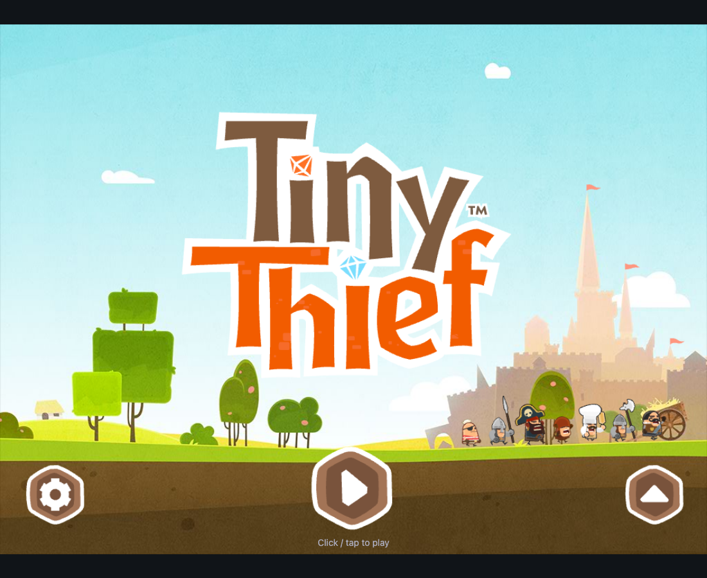
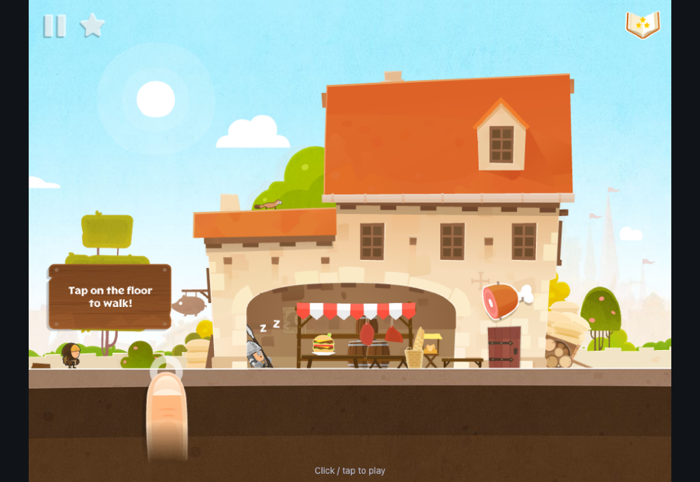

# tinythief-rs

[](https://github.com/LambdaEd1th/tinythief-rs/actions/workflows/ci.yml)
[](https://github.com/LambdaEd1th/tinythief-rs/actions/workflows/pages.yml)
[](https://github.com/LambdaEd1th/tinythief-rs/actions/workflows/release.yml)

A from-scratch Rust host for **Tiny Thief** (Rovio, iOS 1.2.2), built on
[Ruffle](https://github.com/ruffle-rs/ruffle) as the AS3/SWF runtime and `wgpu`
for rendering. It runs as a native desktop application **and** in the browser
from the same code base.

| | |
|---|---|
| ▶ Play in the browser | <https://lambdaed1th.github.io/tinythief-rs/> |
| ⬇ Prebuilt binaries | <https://github.com/LambdaEd1th/tinythief-rs/releases> |
| 📐 Reverse-engineering notes | [docs/TinyThief-architecture.md](docs/TinyThief-architecture.md) |
| 🧭 Feasibility study | [docs/rust-host-feasibility.md](docs/rust-host-feasibility.md) |



The original iOS app is a Scaleform GFx 4 host: the game logic is ActionScript 3
compiled into SWFs, audio is FMOD, and a thin Objective-C shell provides the
platform services. This project replaces that shell: Ruffle executes the
original (encrypted) SWF content, and the Rust host supplies asset decryption,
the native-interface bridge, saves, input and lifecycle handling.

## Quick start

### Play in the browser

Nothing to install — open <https://lambdaed1th.github.io/tinythief-rs/>.
The first visit loads a ~9 MB WebAssembly module and the boot movie (~2 MB);
level assets are fetched on demand. Saves live in IndexedDB (with a
`localStorage` fallback if IndexedDB is unavailable).

### Native desktop build

```bash
# macOS / Linux / Windows, stable Rust
cargo run --release -p tt-host -- crates/tt-web/assets
```

`crates/tt-web/assets` is a complete (encrypted) game bundle, so no separate
copy of the app is needed. You can also point the host at an original
`TinyThief.app`:

```bash
cargo run --release -p tt-host -- /path/to/TinyThief.app
```

Linux build dependencies:

```bash
sudo apt-get install -y libasound2-dev libxkbcommon-dev libwayland-dev pkg-config
```

CLI options:

| Flag | Description |
|---|---|
| `<bundle>` | Path to the app bundle (`TinyThief.app` or `crates/tt-web/assets`) |
| `[boot movie]` | Movie to boot, default `TinyThief.swf` |
| `--capture <png> --frames N` | Headless: render N frames and write a PNG |
| `--click x,y@frame` | Headless: synthetic click at a frame (repeatable) |
| `--snapshot frame:path` | Headless: save a frame at a specific index |
| `--pause-after F --pause-frames N` | Suspend/resume around frame F (lifecycle test) |
| `--quality low\|medium\|high` | Rendering quality; `low` disables anti-aliasing |
| `--frame-rate N` | Override the SWF frame rate (see [High frame rate](#high-frame-rate)) |
| `--always-render` | Disable render-on-demand (A/B profiling only) |

Environment variables: `TT_SAVE_DIR` (override `./saves`), `TT_NO_AUDIO`,
`RUST_LOG` (e.g. `RUST_LOG=info,tt_bridge=debug`).

### Web build from source

```bash
scripts/build_web.sh                 # -> crates/tt-web/dist (wasm + assets)
cd crates/tt-web/dist
python3 -m http.server 8080          # http://127.0.0.1:8080/
```

For a GitHub Pages project site pass the repository prefix:

```bash
scripts/build_web.sh --public-url /tinythief-rs/
```

`trunk` downloads the matching `wasm-bindgen` automatically. If you want to
replace the bundled assets with your own copy of the app, run
`scripts/prepare_web_assets.sh /path/to/TinyThief.app` first.

Web query parameters:

| Parameter | Description |
|---|---|
| `?quality=low\|medium\|high` | Rendering quality (`low` is ~40% cheaper on CPU) |
| `?frameRate=N` | Override the SWF frame rate — this is a speed multiplier, not a high-FPS mode |
| `?assets=<base-url>` | Load assets from elsewhere (CORS required) |
| `?mute=1` | Disable audio (`NullAudioBackend`) |
| `?warmup=N` | Advance N frames before the first paint (screenshots/smoke tests) |
| `?alwaysRender=1` | Disable render-on-demand (profiling only) |

## Repository layout

```
crates/
  tt-assets/    AES-256-CBC bundle reader; decrypts SWF/XML in memory
  tt-platform/  traits for the 4 native interfaces (29 functions) + null backends
  tt-bridge/    ExternalInterface bridge + free in-app purchase flow
  tt-host/      native host: winit + wgpu, cpal audio, disk saves, capture mode
  tt-web/       wasm host: trunk + WebGL, fetch + decrypt, IndexedDB saves
vendor/ruffle/  Ruffle v0.7.1 subset + the call_root_method patch
docs/           architecture notes, web details, verification record, screenshots
scripts/        acceptance test, web build, asset preparation, web smoke test
.github/        CI, Pages and Release workflows
```

## How it works

```
                    ┌──────────────────────────────────────────────┐
  encrypted bundle  │ tt-assets  AES-256-CBC / zero IV / PKCS7     │
  (.app tree)  ───► │            decrypts in memory, never to disk │
                    └───────────────┬──────────────────────────────┘
                                    ▼
  AS3 game logic  ┌──────────────────────────────────────────────┐
  (Ruffle AVM2) ◄─┤ tt-bridge   ExternalInterface, free purchases│
                  └───────────────┬──────────────────────────────┘
                                  ▼
  native: winit + wgpu + cpal      web: canvas + WebGL + WebAudio
  saves: .sol on disk              saves: IndexedDB
```

- **Assets.** The iOS bundle stores every `.swf` and `.xml` encrypted with
  AES-256-CBC (zero IV, PKCS7 padding); MP3s are plaintext. `tt-assets` detects
  and decrypts them on the fly, so no plaintext copy is ever written.
- **Platform services.** The original app calls 29 native functions behind four
  interfaces (`GameServices`, `NativeUtils`, `Flurry`, `IAP`). They are wired
  end-to-end but implemented as **null/no-op** backends: no StoreKit, no Game
  Center, no analytics, no filesystem side effects. This keeps the port honest
  and self-contained.
- **In-app purchases.** Episodes are unlocked by *purchasing them for free at
  purchase time*, not by pre-unlocking content: the host answers
  `IAPInterfaceOnProductInfoReceived` with a price of `0`/`Free`, and on
  `IAPInterfaceOnPaymentCompleted(id, true)` the game runs its normal unlock
  path and writes the save. A fresh save contains no story progress.
- **Ruffle patch.** Ruffle exposes no host→AS3 API, and the game registers no
  `ExternalInterface.addCallback` handlers. The vendored copy adds
  `Player::call_root_method(name, args)`, used for IAP callbacks and the
  `onPaused` / `onResumed` lifecycle hooks. See
  [docs/ruffle-patch.md](docs/ruffle-patch.md). The wasm build also needs
  wasm-safe clock/locale handling (`chrono`/`SystemTime` are unavailable on
  `wasm32-unknown-unknown`), documented in [docs/web.md](docs/web.md).

## Fidelity

| Feature | Native | Web |
|---|---|---|
| Boot to interactive menu | ✅ | ✅ |
| Scripted playthrough (menu → comic → level card → gameplay) | ✅ | ✅ |
| Audio (FMOD MP3 tracks) | ✅ cpal backend | ✅ WebAudio backend |
| Saves (`SharedObject`) | ✅ `.sol` files | ✅ IndexedDB |
| Free in-app purchases | ✅ | ✅ |
| `onPaused` / `onResumed` lifecycle hooks | ✅ | ✅ |
| Multi-touch gestures | ❌ Ruffle has no touch/gesture events | ❌ |



## Performance

The SWF is authored at 24 fps, and the host only renders when Ruffle reports a
new frame (`Player::needs_render()`), so a 60 Hz `requestAnimationFrame` loop
does not render 60 times per second. Measured in headless Chrome with software
WebGL (SwiftShader), tutorial level, 12-second window:

| Configuration | CPU | p50 frame time | fps |
|---|---|---|---|
| Default (render-on-demand, quality=high) | 57% | 16.7 ms | 59.6 |
| `?alwaysRender=1` (old behaviour) | 101% | 50.0 ms | 22.2 |
| Default + `?quality=low` | 34% | 16.7 ms | 60.0 |

The web build also uses `+simd128`, thin LTO and `codegen-units = 1`, which
shrinks the wasm from 9.7 MB to 9.0 MB.

### High frame rate

There is no real "unlock the frame rate" mode. The game is frame-locked to
24 Hz by design: the loop is driven by `Event.ENTER_FRAME`, `update()` methods
take no delta time, movement is applied as fixed per-frame steps, and 225 AS3
files drive timeline animations (`gotoAndStop/Play`). Raising the frame rate
therefore speeds the whole game up — with `?frameRate=60` the boot animation
runs 2.5× faster (the menu appears after 3.2 s instead of 5.4 s, of which
~1.7 s is fixed loading), which makes it a debug/speed-run knob, not a
smoothness option. On a 60 Hz display, 24 fps content inherently judders
(frames land 2.5 rAF ticks apart); the only faithful fix would be render-time
motion interpolation, which would require a deep Ruffle fork. See
[docs/web.md](docs/web.md) for the full assessment.

## Testing

```bash
cargo test --workspace        # asset pipeline + unit tests
scripts/verify.sh             # end-to-end acceptance run (writes build/verify/*.png)
scripts/web_smoke.py --url http://127.0.0.1:8080/ --seconds 25 \
    --profile /tmp/tt-profile --expect-keys 3
```

`scripts/verify.sh` boots the host headlessly and checks: menu reached, fresh
save has **no** story progress, scripted clicks reach gameplay, taps move the
character, pause freezes the frame, captures are deterministic, a free purchase
unlocks an episode, platform services write no state, and the save survives a
second run (`Session_ID` increments).

The web smoke test drives a real-time headless Chrome via CDP (Chrome's
`--virtual-time-budget` does not deliver IndexedDB callbacks) and prints
`player_ready=True panic=False indexeddb_keys=N`.

## CI / CD

| Workflow | Trigger | What it does |
|---|---|---|
| `ci.yml` | push to `main`, PRs | `cargo fmt --check`, `clippy -D warnings`, `cargo test --workspace`, wasm check |
| `pages.yml` | push to `main` | builds the wasm bundle and deploys it to GitHub Pages |
| `release.yml` | tag `v*` | builds macOS arm64, Windows/Linux arm64 + x86_64 binaries and publishes a GitHub Release |

Create a release with:

```bash
git tag v0.1.1 && git push origin v0.1.1
```

## Known limitations

- **Web audio needs a click** — the `AudioContext` is created lazily on the
  first pointer/key event. Safari refuses to play a context created outside a
  gesture, so the backend defers initialization instead of resuming early.
- **24 fps content** — see [High frame rate](#high-frame-rate); judder on 60 Hz
  displays is inherent to the source material.
- **Multi-touch gestures** are not supported: Ruffle's event model only exposes
  mouse, keyboard and gamepad, so single-pointer input works but pinch/zoom
  gestures do not.
- **Platform services are deliberately null** — no Game Center, StoreKit, Play
  Billing, Steamworks or analytics.
- **Initial web load** is ~9 MB wasm plus the boot movie; subsequent levels
  stream in on demand.

## Legal

The Tiny Thief game content (SWF, XML, MP3) is © Rovio Entertainment Ltd. It is
included **only** for technical research and personal preservation, is **not**
covered by this repository's license, and must not be redistributed or used
commercially without permission. See [NOTICE.md](NOTICE.md). If you are a rights
holder and want the content removed, please open an issue.

The host code is licensed under MIT OR Apache-2.0 — see [LICENSE-MIT](LICENSE-MIT)
and [LICENSE-APACHE](LICENSE-APACHE).

## Credits

- [Ruffle](https://github.com/ruffle-rs/ruffle) — the AS3/AVM2 runtime and SWF
  renderer that makes this possible.
- Rovio — for Tiny Thief.
